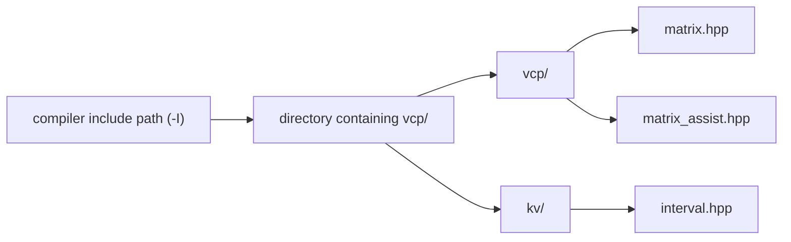
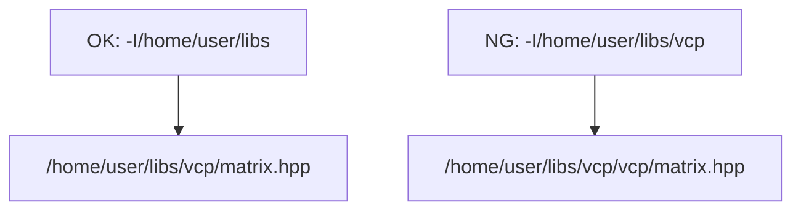

# Installation

VCP Library はヘッダ中心のライブラリです。基本的なインストールは、
`vcp/` ディレクトリを利用したい場所に置き、コンパイル時の include path に
`vcp/` を含むディレクトリを指定するだけです。

区間演算や高精度計算で kv ライブラリも使う場合は、`vcp/` と `kv/` を
同じ親ディレクトリに置く配置を推奨します。この配置では include path を
1 つ指定するだけで、`#include <vcp/...>` と `#include <kv/...>` の両方を
解決できます。

`vcp/` ディレクトリそのものを include path に指定しない点に注意してください。

## 基本の考え方

VCP のヘッダは次のように include します。

```cpp
#include <vcp/matrix.hpp>
#include <vcp/matrix_assist.hpp>
```

`matrix.hpp` は `vcp::matrix` 本体のヘッダです。`matrix_assist.hpp` は
行列の利用でよく使う補助機能をまとめて読み込むヘッダで、型変換や
ファイル入出力などを使う場合にも利用します。

そのため、コンパイラには `vcp/` の中ではなく、`vcp/` が置かれている
親ディレクトリを渡します。kv を使う場合も、同じ親ディレクトリに `kv/` を
置いておくと同じ include path で利用できます。



## 正しい配置例

例えば次のように配置したとします。

```text
/home/user/libs/
├── vcp/
│   ├── matrix.hpp
│   ├── matrix_assist.hpp
│   ├── mats.hpp
│   └── ...
└── kv/
    ├── interval.hpp
    ├── rdouble.hpp
    └── ...
```

この場合、include path に指定するのは
`/home/user/libs` です。

```bash
g++ -std=c++20 -ffp-contract=off -frounding-math -I/home/user/libs example.cpp
```

`#include <vcp/matrix.hpp>` に対して、コンパイラは次のファイルを探します。

```text
/home/user/libs/vcp/matrix.hpp
```

`#include <kv/interval.hpp>` に対しては、次を探します。

```text
/home/user/libs/kv/interval.hpp
```

## 間違いやすい例

次のように `vcp/` ディレクトリそのものを include path に指定しないでください。

```bash
g++ -std=c++20 -ffp-contract=off -frounding-math -I/home/user/libs/vcp example.cpp
```

この指定だと、`#include <vcp/matrix.hpp>` に対してコンパイラは次を探します。

```text
/home/user/libs/vcp/vcp/matrix.hpp
```

つまり `vcp/` が二重になり、ヘッダを見つけられません。



## kv ライブラリを使う場合

区間演算や高精度計算を使う場合は、VCP Library とは別に kv ライブラリを
取得してください。kv のヘッダは次のように include します。

```cpp
#include <kv/interval.hpp>
#include <kv/rdouble.hpp>
```

そのため、kv についても `kv/` ディレクトリそのものではなく、
`kv/` が置かれているディレクトリを include path に指定します。
推奨配置では `vcp/` と `kv/` が同じ親ディレクトリにあるため、
include path は 1 つで済みます。

配置例:

```text
/home/user/libs/
├── vcp/
│   ├── matrix.hpp
│   └── ...
└── kv/
    ├── interval.hpp
    ├── rdouble.hpp
    └── ...
```

この場合のコンパイル例:

```bash
g++ -std=c++20 -ffp-contract=off -frounding-math -I/home/user/libs example.cpp
```

コンパイラから見える必要があるファイルは次の 2 つです。

```text
/home/user/libs/vcp/matrix.hpp
/home/user/libs/kv/interval.hpp
```

## リポジトリ内のサンプルをコンパイルする場合

このリポジトリの `test_matrix/` などでサンプルをコンパイルする場合、
1 つ上のディレクトリが `vcp/` を含んでいます。kv を同じ親ディレクトリに
置いている場合は、`-I..` だけで `vcp/` と `kv/` の両方を参照できます。

```text
project-root/
├── vcp/
├── kv/
└── test_matrix/
    └── test_matrix.cpp
```

そのため、`test_matrix/` の中からコンパイルする例は次のようになります。

```bash
cd test_matrix
g++ -std=c++20 -ffp-contract=off -frounding-math -I.. test_matrix.cpp
```

ここで `..` は `vcp/` と `kv/` を含む親ディレクトリを指します。

## ダウンロード補助ツール

GitHub archive や tar ファイルの展開に慣れていない場合は、
`tools/download_vcp_kv.sh` を使えます。このツールは、kv ライブラリと
VCP Library をダウンロードし、`vcp/` と `kv/` を同じ親ディレクトリに
配置します。あわせて `test_matrix/`、`test_PDE/`、`docs/` なども展開します。
kv ライブラリは [mskashi/kv](https://github.com/mskashi/kv) の GitHub archive から
取得します。

このツールは `sudo`、`apt`、`dnf`、`.bashrc` の編集、Intel MKL/oneAPI の
導入を行いません。必要な外部ライブラリは、利用する環境に合わせて別途
導入してください。

利用例:

```bash
bash tools/download_vcp_kv.sh vcp-work
```

この例では、現在のディレクトリではなく、ホームディレクトリの下に
次のような配置を作ります。

```text
~/vcp-work/
├── vcp/
├── kv/
├── test_matrix/
├── test_PDE/
├── docs/
├── tools/
├── README.md
└── LICENSE
```

展開後、例えば行列クラスの例を確認する場合は次のようにします。

```bash
cd ~/vcp-work/test_matrix
g++ -std=c++20 -ffp-contract=off -frounding-math -I.. test_matrix.cpp
```

BLAS/LAPACK を使う場合は、BLAS の演算が丸めモード変更を反映するかも
確認してください。OpenBLAS を使う場合の例:

```bash
cd ~/vcp-work/test_matrix
g++ -I.. -std=c++20 -ffp-contract=off -frounding-math -DNDEBUG -DKV_FASTROUND -O3 Check_pdblas_rounding.cpp -llapack -lopenblas -lmpfr -lgmp -fopenmp && ./a.out
g++ -I.. -std=c++20 -ffp-contract=off -frounding-math -DNDEBUG -DKV_FASTROUND -O3 Check_pidblas_rounding.cpp -llapack -lopenblas -lmpfr -lgmp -fopenmp && ./a.out
```

Intel MKL やその他の BLAS/LAPACK を使う場合は、リンクオプションや
oneAPI/MKL の環境設定が異なります。[blas_build.md](blas_build.md) を
参照してください。

`tools/download_vcp_kv.sh` は `wget` と `tar` を使います。
これらが入っていない環境では、先に導入してください。

## 外部ライブラリが必要な場合

通常の `vcp::matrix<double>` だけなら、VCP のヘッダを配置して include path を
指定すれば利用できます。

一方、選択する policy やスカラー型によっては、追加の外部ライブラリが必要です。

| 用途 | 追加で必要なもの |
| --- | --- |
| 区間演算 | kv ライブラリ |
| `kv::mpfr` | MPFR |
| `vcp::pdblas`, `vcp::pidblas` | BLAS/LAPACK または Intel MKL(`-DUSE_VCP_BLAS -DUSE_VCP_LAPACK` 指定時は不要) |
| `vcp::pddblas` | 上に加えて kv ライブラリ(`kv::dd`) |
| `vcp::mats2<double>`・`vcp::mats2<kv::dd>` の特殊化ヘッダ | BLAS/LAPACK または Intel MKL(`-DUSE_VCP_BLAS -DUSE_VCP_LAPACK` 指定時は不要) |
| `vcp::spumar` | UMFPACK(SuiteSparse)、ARPACK-NG |
| `vcp::spcmodumar` | UMFPACK・CHOLMOD(SuiteSparse)、ARPACK-NG |
| OpenMP を使うビルド | OpenMP 対応コンパイラとリンクオプション |

疎行列の既定の policy `vcp::spmats<T>` と区間疎行列の policy `vcp::spimats<T>` は、
追加の外部ライブラリなしで使えます。

## 疎行列の外部委譲 policy を使う場合

`vcp::spumar` と `vcp::spcmodumar` を使う場合は、SuiteSparse と ARPACK-NG の
開発用パッケージを入れます。

Ubuntu の例:

```bash
sudo apt install libsuitesparse-dev libarpack2-dev
```

リンクには次のオプションを付けます。

| policy | リンクオプション |
| --- | --- |
| `vcp::spumar` | `-lumfpack -larpack` |
| `vcp::spcmodumar` | `-lumfpack -larpack -lcholmod` |

外部ライブラリが必要になるのは、`vcp/spumar.hpp` または `vcp/spcmodumar.hpp` を
include した翻訳単位だけです。これらのライブラリのライセンスについては
[spmatrix.md](spmatrix.md) の「外部ライブラリのライセンスに関する注意」を
参照してください。

## 必須のコンパイルオプション

VCP を使うコードは、次の 2 つを必ず付けてコンパイルします。

```bash
-ffp-contract=off -frounding-math
```

- `-ffp-contract=off` は、コンパイラが `a*b+c` の形の計算を 1 つの命令(FMA)にまとめることを止めます。
  VCP と kv の区間演算や `kv::dd` の演算は、演算が 1 つずつ、書いたとおりに丸められることを前提にしています。
- `-frounding-math` は、丸めモードを実行のときに切り替えることを、コンパイラに伝えます。

FMA の命令は、x86 では `-march=native`・`-mfma`・`-mavx512f` などを付けたとき、
Apple Silicon では何も付けなくても使われます。そのため、最適化の有無や機体によらず、常に付けてください。

VCP の `double` の行列積(rdblas)の SIMD の実装と、外部の BLAS は、このオプションを付けても FMA を使います。

コンパイラは、この 2 つのオプションを指定できるものを使ってください。gcc と clang は、どちらも指定できます。

kv のコンパイルオプション(丸めモードの切り替え方を選ぶ `-DKV_FASTROUND` など)は、
kv の説明 <https://verifiedby.me/kv/rounding/index.html> を参照してください。

## 推奨する基本パッケージ

VCP Library 本体はヘッダを配置するだけで利用できますが、実際の数値計算では
開発環境、Boost、GMP、MPFR、BLAS/LAPACK、SuiteSparse、ARPACK-NG を入れておくと便利です。

Ubuntu の例:

```bash
sudo apt install build-essential libboost-all-dev libgmp-dev libmpfr-dev liblapack-dev libsuitesparse-dev libarpack2-dev
```

Rocky Linux などの Red Hat 系 Linux の例:

```bash
sudo dnf groupinstall "Development Tools" -y
sudo dnf install dnf-plugins-core epel-release -y
sudo dnf config-manager --set-enabled crb
sudo dnf install boost-devel gmp-devel mpfr-devel lapack-devel suitesparse-devel arpack-devel -y
```

`lapack-devel` と `suitesparse-devel` は CRB、`arpack-devel` は EPEL にあるので、先に両方を有効にします。

Ubuntu 22.04 の Boost 1.74 など古い Boost は、uBLAS が C++20 に対応していないため、
kv を使うコードを `-std=c++20` でコンパイルできないことがあります。その場合は
`-std=c++17` を指定するか、新しい Boost を使ってください。

最適化つきでビルドするときは、`-O3` に加えて `-march=native` を付けることを勧めます。
`-march=native` は、ビルドする機体の CPU の命令(AVX2・AVX-512 など)を有効にします。
`double` の行列の計算は、既定では VCP の実装(rdblas)で行い、このフラグで SIMD の実装が
使われます。ビルドした実行ファイルは、命令の種類が違う CPU の機体では動かないことがあります。

BLAS/LAPACK、Intel MKL、OpenBLAS、OpenMP の設定例は
[blas_build.md](blas_build.md) を参照してください。

旧 `installer/` スクリプトについては
[legacy/legacy_installers.md](legacy/legacy_installers.md) にメモを残しています。
